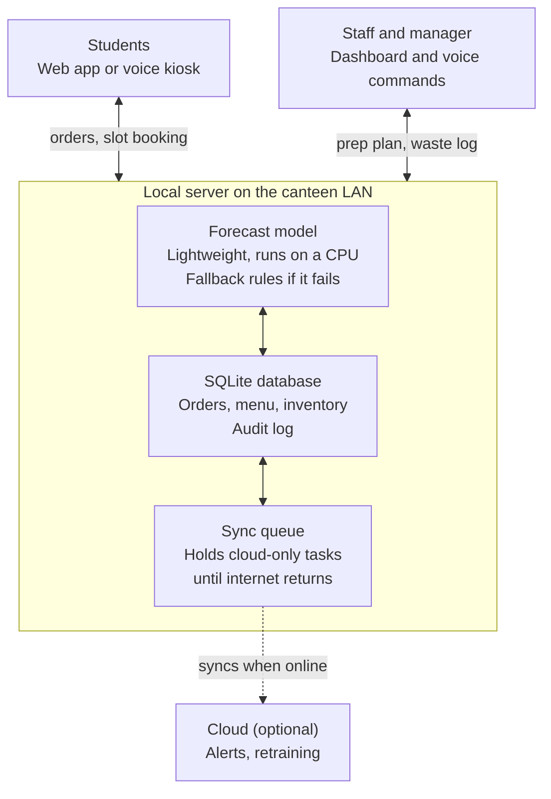

# SmartCanteen AI Documentation

*Last updated: 2026-10-12*

SmartCanteen AI cuts food waste and queue time in a college canteen by forecasting demand before cooking and spreading pickups across time slots.

## Overview

**Problem statement:** Smart Canteen: reduce food waste and waiting time in the college canteen. The solution should help the canteen prepare the right quantity of food, reduce excess food, and serve students faster.

**Technology card:** Artificial Intelligence (AI). The AI makes decisions (how much to cook, when) and automates tasks (slot suggestions, voice commands).

Waste and long queues share one root cause: the canteen does not know what students will want, or when. SmartCanteen AI predicts demand before cooking, then spreads that demand over pickup slots.

**Pitch line:** "We don't cook more or less. We cook right, and at the right time."

## How the AI works

The main AI component is a demand forecaster. Four smaller pieces feed it or build on it.

1. **Demand forecasting.** A model predicts portions sold per item per time slot. It returns a quantity and a confidence range, e.g. "Veg biryani: 120 portions (range 105 to 135)". The kitchen gets a batch plan such as "cook 60 now, 40 at 12:15, hold the rest", so food is cooked in small batches instead of one large batch.
2. **Pre-order and slot booking.** Students order from a web page or app and pick a pickup slot (e.g. 1:05 to 1:10 pm). This gives the model real demand data and spreads the crowd.
3. **Wait-time prediction.** The system estimates the current queue time from open orders and counter speed, then nudges students to a quieter slot: "Pick up at 1:15 instead and skip a 12-minute wait."
4. **Waste feedback loop.** At closing, staff log leftovers per item in a few taps. The model learns from them, and a dashboard shows waste per item and per day. Optionally, NLP on ratings and comments separates items wasted because of taste from items wasted because of bad forecasts.
5. **Leftover handling.** In the last 30 minutes, safe surplus is listed at a discount, or an alert goes to an NGO or hostel for donation.

## Features

| Feature | Used by | What it does |
| --- | --- | --- |
| Demand forecast | Kitchen manager | Predicts portions per item per slot with a confidence range |
| Prep plan | Kitchen staff | Turns the forecast into batch sizes and cook times |
| Pre-order and slot booking | Students | Orders ahead and picks a pickup slot |
| Wait-time estimate | Students | Shows the live queue time and suggests a quieter slot |
| Voice commands | Staff and students | Hands-free ordering, sold-out marking and leftover logging |
| Waste log and dashboard | Manager | Records leftovers and shows waste per item and per day |
| Leftover alerts | Manager | Lists surplus at a discount or alerts an NGO or hostel |
| Audit log | Manager | Records every staff action for review |

## Design constraints

Each constraint from the brief has a concrete implementation and a way to show it live.

| Constraint | Implementation | Demo |
| --- | --- | --- |
| Hands-free | Voice commands for a small, fixed set of tasks. Staff: "mark biryani sold out", "log 5 leftover samosas", "show prep plan". Students: "order two masala dosa for 1:15", "what's my wait time?". Intent matching uses keywords plus item names, with a confirmation step ("Two masala dosa at 1:15, confirm?"). Touch stays available for everything. | Say a command live and show the order appear on the dashboard |
| Low energy | Lightweight models (LightGBM or a moving average) that run in milliseconds on a CPU. Weekly retraining, not continuous. Inference runs only when a slot plan is needed, and results are cached. Updates are event-driven, not polled. The mic listens only after a button press or wake word. Hosted on one small device (Raspberry Pi or college PC). | Show model size and inference time, measured in the prototype |
| Internet outage | Local-first design: a server on the canteen LAN holds orders, menu, inventory and the model in SQLite. Offline voice uses a small on-device engine such as Vosk. Cloud-only extras (push notifications, NGO alerts, retraining) queue and sync when the connection returns. | Disconnect the internet and show ordering and the prep plan still working |
| Hack-proof / security | Layered security by design (see Security). No system can be guaranteed completely hack-proof. | Show a student account refused access to the staff dashboard |
| Prediction | Per-item, per-slot demand forecast with a confidence range and a recommended prep quantity. | Show predicted vs. actual sales and the prep plan |
| Main feature removed | A graceful-degradation ladder (see Fallback plan). Orders, billing and serving never depend on the model. | Switch the AI off with a toggle and show the system carrying on |

## Security

The system is secured in layers. We describe it as secure by design, not hack-proof, because no system can honestly claim to be unhackable.

- **Role-based access:** student, counter staff and manager. Only managers can change the menu, inventory or settings.
- **Authentication:** college ID with a bcrypt-hashed password, short-lived sessions, and a PIN for staff voice actions.
- **Input validation:** whitelist item names, cap quantities and orders per slot, and use parameterized queries against SQL injection.
- **Abuse limits:** rate limiting and one active order per student per slot.
- **Data protection:** HTTPS on the LAN, minimal personal data, encrypted backups, and an audit log of every staff action.
- **Voice safety:** voice commands pass through the same role checks and confirmation steps as touch.

## Fallback plan if AI prediction is unavailable

The AI improves the canteen but does not gate it. If prediction fails, the system steps down through these levels instead of stopping:

1. **Normal:** AI forecast combined with pre-orders gives the prep plan.
2. **AI down:** use the same weekday's average over the last 4 weeks, adjusted by the current pre-order count, plus a small safety buffer.
3. **Data down too:** the manager uses a saved "last week's plan" template and adjusts it by hand.
4. **Pre-ordering down:** a token-based counter queue, with the kitchen cooking popular items in small batches.

## Data, model and metrics

The forecaster is a gradient-boosting model (LightGBM or XGBoost), with Prophet or a moving average as lighter alternatives.

| Item | Detail |
| --- | --- |
| Inputs | Day of week, class timetable (break times), exam or event days, holidays, weather, past sales, past leftovers, live pre-orders |
| Output | Portions per item per time slot, with a low and high range, plus a recommended prep quantity |
| Training data | 2 to 4 weeks of real canteen sales, or realistic synthetic data for the demo |
| Retraining | Weekly, using the leftover log as feedback |

**Success metrics.** Forecast error (predicted vs. actual portions per slot), waste rate (leftover portions divided by prepared portions), and average wait time per order. Improvements are reported as simulation results or targets unless tested on real canteen data.

## Tech stack and demo plan

**Suggested stack:** Python, scikit-learn or LightGBM, FastAPI or Streamlit, SQLite (Firebase as an online option), React or plain HTML, Vosk for offline voice.

**Demo plan:**

1. **Data:** generate realistic synthetic sales data, or collect 2 to 4 weeks from the canteen.
2. **Model:** train the forecaster and show predicted vs. actual sales.
3. **UI:** a student ordering page and a kitchen dashboard with the prep plan.
4. **Constraints live:** give a voice command, unplug the internet, switch the AI off, and try a student login on the staff page.
5. **Impact:** simulate "without AI vs. with AI" and compare waste and average wait.

## Assumptions and limitations

- Forecast quality depends on how much sales history exists. With little data, the model falls back to weekday averages.
- Waste and wait-time improvements are targets or simulation results until tested on a real canteen.
- Offline voice recognition is less accurate than cloud speech services, so every voice order needs a confirmation step.
- Students need campus Wi-Fi or a kiosk to reach the local server.
- Security reduces risk but cannot make the system unhackable.

## System architecture

Everything essential runs on the canteen local server. Students and staff talk only to the local server, which holds the data, the forecast model and a sync queue. The cloud is optional and used only when the internet is up.



Plain-text version:

```
Students (web app / voice kiosk) ─┐                     ┌─ Staff and manager (dashboard / voice)
                                  ▼                     ▼
        ┌──────────── Local server on the canteen LAN ────────────┐
        │  Forecast model  <->  SQLite database  <->  Sync queue  │
        └──────────────────────────────────────────────┬──────────┘
                                                       ┊ syncs when online
                                                Cloud (optional)
```
