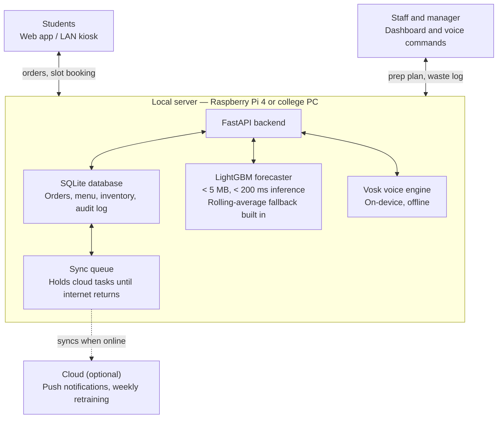

# SmartCanteen AI Documentation

*Last updated: 2026-10-12*

SmartCanteen AI cuts food waste and queue time in a college canteen by forecasting demand before cooking and spreading pickups across time slots.

## Overview

**Problem statement:** Smart Canteen: reduce food waste and waiting time in the college canteen. The solution should help the canteen prepare the right quantity of food, reduce excess food, and serve students faster.

**Technology card:** Artificial Intelligence (AI). The AI makes decisions (how much to cook, when) and automates tasks (slot suggestions, voice commands).

Waste and long queues share one root cause: the canteen does not know what students will want, or when. SmartCanteen AI predicts demand before cooking, then spreads that demand over pickup slots.

**Pitch line:** "We don't cook more or less. We cook right, and at the right time."

## How the AI works

The main AI component is a demand forecaster. Four smaller pieces feed it or build on it.

1. **Demand forecasting.** A LightGBM model predicts portions sold per item per 15-minute slot. It returns a quantity and a confidence range, e.g. "Veg biryani: 120 portions (range 105–135)". The kitchen gets a batch plan such as "cook 60 now, 40 at 12:15, hold the rest", so food is cooked in small batches instead of one large batch.
2. **Pre-order and slot booking.** Students order from a web page and pick a pickup slot (e.g. 1:05–1:10 pm). This gives the model real demand data and spreads the crowd across slots.
3. **Wait-time prediction.** The system counts open orders for the next slot and divides by counter throughput (configurable, default 2 orders/minute) to estimate queue time. If the estimated wait exceeds 5 minutes, the UI nudges the student to a quieter slot: "Pick up at 1:15 instead and skip a 12-minute wait." The threshold and throughput rate are stored in the database and editable by the manager.
4. **Waste feedback loop.** At closing, staff log leftovers per item in a few taps. The model retrains weekly using the leftover log as a signal, and a dashboard shows waste per item and per day.
5. **Leftover handling** *(extension, not core).* In the last 30 minutes, safe surplus can optionally be listed at a discount on the student ordering page. NGO/hostel donation alerts require internet and are outside the core demo scope.

## Features

| Feature | Used by | What it does |
| --- | --- | --- |
| Demand forecast | Kitchen manager | Predicts portions per item per slot with a confidence range |
| Prep plan | Kitchen staff | Turns the forecast into batch sizes and cook times |
| Pre-order and slot booking | Students | Orders ahead and picks a pickup slot |
| Wait-time estimate | Students | Shows live queue time and suggests a quieter slot |
| Voice commands | Staff and students | Hands-free ordering, sold-out marking and leftover logging |
| Waste log and dashboard | Manager | Records leftovers and shows waste per item and per day |
| Leftover discount *(extension)* | Manager | Lists safe surplus at a discount in the last 30 minutes |
| Audit log | Manager | Records every staff action for review |

## Non-functional requirements

Beyond core features, the system is designed around six requirements that reflect the realities of a college canteen environment: shared devices, unreliable internet, limited hardware, and the need to protect student and staff data. Each has a concrete implementation and a way to show it live.

### Hands-free (voice commands)

Voice is available for a fixed set of tasks. Touch remains available for everything — voice is an addition, not a replacement.

**Supported commands:**

| Role | Example command | Action |
| --- | --- | --- |
| Student | "order two masala dosa for 1:15" | Places order for slot 1:15 |
| Student | "what's my wait time?" | Reads out estimated queue time |
| Staff | "mark biryani sold out" | Sets item stock to 0 |
| Staff | "log 5 leftover samosas" | Records 5 leftover samosas in the waste log |
| Staff | "show prep plan" | Displays current batch plan on screen |

**Technical pipeline:**

1. User presses a push-to-talk button (no always-on listening to save energy and reduce false triggers).
2. Audio is captured and passed to **Vosk** (on-device, offline-capable speech engine).
3. The transcript is matched against a keyword + item-name grammar. Item names come from the live menu in SQLite, so new items are automatically recognised.
4. Parsed intent and parameters are shown to the user for confirmation: "Two masala dosa at 1:15 — confirm?"
5. On confirmation, the same API endpoint used by the touch UI is called, so voice goes through identical role checks and validation.
6. Staff voice actions additionally require a 4-digit PIN before execution.

**Error handling:** if Vosk returns a transcript with no matching intent, the UI shows "Sorry, I didn't catch that — please try again or use the touch screen." Unrecognised item names are caught at the grammar stage; the user is shown the closest menu match and asked to confirm.

**Demo:** say a command live → show the order appear on the dashboard in real time.

### Low energy

The system is designed to run on a single Raspberry Pi 4 (4 GB) or equivalent college PC without a GPU.

| Target | Value |
| --- | --- |
| Model size (LightGBM, serialised) | < 5 MB |
| Inference time per slot plan | < 200 ms on a Raspberry Pi 4 CPU |
| Retraining frequency | Once per week, triggered manually or by cron |
| Mic active time | Only while push-to-talk button is held |
| Background polling | None — all updates are event-driven (order placed, slot changed, waste logged) |

Inference runs only when a new slot plan is needed. Results are cached until the next order event invalidates them. The model is not retrained continuously.

**Demo:** show the serialised model file size and time a live inference call; both are measured in the prototype before the demo.

### Internet outage

The system is local-first. Every essential function runs on the canteen LAN server with no internet dependency.

| Function | Online | Offline |
| --- | --- | --- |
| Student ordering | ✓ | ✓ (via LAN) |
| Slot booking | ✓ | ✓ (via LAN) |
| Prep plan and forecast | ✓ | ✓ (model runs locally) |
| Voice commands | ✓ | ✓ (Vosk, on-device) |
| Waste log | ✓ | ✓ (SQLite, local) |
| Push notifications | ✓ | ✗ (queued, sent when reconnected) |
| Weekly model retraining via cloud | ✓ | ✗ (queued, runs when reconnected) |
| NGO/donation alerts | ✓ | ✗ (queued) |

A sync queue in SQLite holds any cloud-only tasks. When the internet returns, the queue drains automatically.

**Demo:** disconnect the internet router → place an order → view the prep plan → everything works. Reconnect → show the sync queue flush.

### Security

The system is secured in layers. We describe it as secure by design, not hack-proof, because no system can honestly claim to be completely unhackable.

- **Role-based access:** three roles — student, counter staff, manager. Role is set at registration and stored in the database. Only managers can change the menu, inventory or settings.
- **Authentication:** college ID with a bcrypt-hashed password (cost factor 12), short-lived JWT sessions (1-hour expiry), and a 4-digit PIN required for all staff voice actions.
- **Input validation:** item names are validated against the menu whitelist; quantities are capped (max 10 per order); all database queries use parameterised statements to prevent SQL injection.
- **Abuse limits:** rate limiting (max 10 requests/minute per IP) and one active order per student per slot.
- **Data protection:** HTTPS enforced on the LAN, minimal personal data stored (college ID and hashed password only), encrypted SQLite backups, and an append-only audit log of every staff action.
- **Voice safety:** voice commands go through the same role checks and input validation as touch, plus the PIN step for staff.

**Demo:** log in as a student → attempt to open the staff dashboard URL → show the 403 response.

### Prediction

A **LightGBM** classifier trained on synthetic sales data (generated to match realistic college canteen patterns — see Data section) predicts portions per item per 15-minute slot.

Output example:

```
Slot 12:30–12:45
  Veg biryani:    predicted 68  (range 59–77)   → cook 65 now
  Masala dosa:    predicted 34  (range 29–39)   → cook 30 now, 10 at 12:15
  Paneer wrap:    predicted 21  (range 17–25)   → cook 20 now
```

The prep plan adds a 10% safety buffer to the lower bound of the range and rounds to a practical batch size (multiples of 10).

**Demo:** show predicted vs. actual sales on a held-out slice of the synthetic dataset; display the prep plan on the kitchen dashboard.

### Graceful degradation (main feature removed)

If AI prediction is unavailable the system steps down through four levels. Orders, billing and serving never depend on the model at any level.

| Level | Condition | What the system does |
| --- | --- | --- |
| 1 — Normal | Model running, pre-orders flowing | AI forecast + pre-order count = prep plan |
| 2 — AI down | Model fails or is toggled off | Same weekday average from the last 4 weeks, adjusted by current pre-order count, plus 10% buffer |
| 3 — Data down too | No historical data available | Manager loads a saved "last week's plan" template and adjusts quantities by hand |
| 4 — Pre-ordering down | Ordering system unavailable | Token-based counter queue; kitchen cooks popular items in small rolling batches |

A toggle on the manager dashboard switches between levels 1 and 2 instantly.

**Demo:** flip the AI toggle off → show the prep plan regenerates from weekday averages with no error.

## Data and model

**Stack decision:** LightGBM is used for the forecaster. It is fast (< 200 ms inference), small (< 5 MB serialised), runs on CPU, and outperforms a moving average on datasets with categorical features like day-of-week and event flags. A 7-day rolling average is kept as the level-2 fallback — it requires no model file and no inference step.

**Training data:** synthetic sales data generated for the demo. The generator produces 6 weeks of realistic per-item, per-slot sales counts using the following rules:
- Base demand varies by item and slot (lunch peak 12:00–13:30, smaller tea-time peak 16:00–16:30).
- Monday and Friday have 10–15% higher demand than midweek.
- Exam days add 20% to quick items (wraps, dosa) and reduce biryani by 15%.
- Gaussian noise (σ = 8% of mean) is added to every slot.

The model is trained on weeks 1–5 and validated on week 6 to produce a measurable forecast error for the demo.

| Item | Detail |
| --- | --- |
| Inputs | Day of week, slot index, is_exam_day, is_event_day, is_holiday, rolling_7d_avg per item, pre_order_count per slot |
| Output | Portions per item per slot, with a low and high bound (10th and 90th percentile) |
| Training data | 6 weeks of synthetic data; model validated on held-out week 6 |
| Retraining | Weekly, triggered by cron or manually by manager; uses leftover log as an additional signal |

**Success metrics:**

| Metric | Definition | Target (simulation) |
| --- | --- | --- |
| MAE (forecast error) | Mean absolute error, portions per slot | < 8 portions |
| Waste rate | Leftover portions ÷ prepared portions | < 10% |
| Average wait time | Mean queue time per order across peak slots | < 4 minutes |

## Tech stack

Decisions are final. Every "or" from the earlier draft has been resolved.

| Layer | Choice | Reason |
| --- | --- | --- |
| Language | Python 3.11 | Broad library support, team familiarity |
| Backend | FastAPI | Lightweight, async, auto-generates OpenAPI docs |
| Forecaster | LightGBM | Fast CPU inference, small model file, handles categorical features well |
| Fallback model | 7-day rolling average | No file, no inference, always available |
| Database | SQLite (via SQLAlchemy) | Zero-config, local-first, sufficient for canteen scale |
| Frontend | Plain HTML + vanilla JS | No build step, works on any browser on the LAN, easy to demo offline |
| Offline voice | Vosk (small English model, ~50 MB) | Runs fully on-device, no internet needed, Python bindings available |
| Hosting | Single machine — Raspberry Pi 4 or college PC | Meets the low-energy constraint, no cloud dependency for core features |

## Demo plan

1. **Data:** run the synthetic data generator to produce 6 weeks of sales data. Train LightGBM on weeks 1–5, validate on week 6, print MAE.
2. **Model:** show the prep plan for today's simulated lunch peak. Compare predicted vs. actual on the week-6 holdout.
3. **UI:** walk through the student ordering page (place an order, see wait time, get a slot nudge) and the kitchen dashboard (prep plan, waste log, leftover counts).
4. **Constraints live:**
   - Say a voice command → order appears on the dashboard.
   - Disconnect the internet → place an order and view the prep plan → both work.
   - Flip the AI toggle off → prep plan regenerates from averages.
   - Log in as a student → try to open `/staff/dashboard` → show the 403.
5. **Impact:** show the simulated "without AI vs. with AI" comparison: waste rate and average wait time across the 6-week synthetic dataset.

## Fallback plan if AI prediction is unavailable

See the "Main feature removed" constraint above for the full four-level degradation ladder. The key principle: no customer-facing action (ordering, pickup, billing) ever depends on the model being available.

## Assumptions and limitations

- All waste and wait-time improvements are simulation results on synthetic data until tested on a real canteen.
- Vosk's small English model has lower accuracy than cloud speech services (~90% word accuracy on clean audio). The mandatory confirmation step catches most misrecognitions before any action is taken.
- Students need campus Wi-Fi or access to a LAN kiosk. There is no public internet endpoint in the core design.
- Forecast quality improves with more historical data. With fewer than 2 weeks of data, the model falls back to day-of-week averages automatically.
- Security measures reduce risk significantly but cannot make the system unhackable.

## System architecture

Everything essential runs on the canteen local server. Students and staff communicate only with the local server. The cloud is optional and used only when the internet is available.



Plain-text version:

```
Students (web / kiosk) ──┐                    ┌── Staff and manager (dashboard / voice)
                         ▼                    ▼
      ┌──────── Local server (Raspberry Pi 4 or college PC) ────────┐
      │  FastAPI  <->  SQLite  <->  LightGBM  <->  Vosk (voice)    │
      │                    <->  Sync queue                          │
      └───────────────────────────────────────────┬─────────────────┘
                                                  ┊ syncs when online
                                           Cloud (optional)
```
